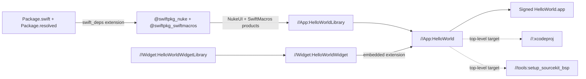
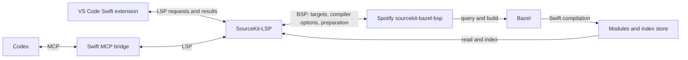

# Bazel for iOS

A SwiftUI app with a WidgetKit extension, real [NukeUI](https://github.com/kean/Nuke) and [SwiftMacros](https://github.com/Aeastr/SwiftMacros) dependencies. Bazel owns the build graph. This guide explains that structure, how to set up a checkout, and how Spotify's build server supplies SourceKit-LSP with the context needed for VS Code and Codex navigation.

- [Bazel project structure](#bazel-project-structure)
- [Set up the checkout](#set-up)
- [BSP installation and SourceKit-LSP connection](#bsp-installation-and-sourcekit-lsp-connection)
- [Use VS Code and Codex](#use-vs-code-and-codex)
- [Verify the connection](#verify-the-connection)
- [Build and run the sample](#build-and-run-the-sample)
- [Troubleshooting](#troubleshooting)

## Bazel project structure

| File or directory | Responsibility |
| --- | --- |
| `.bazelversion` | Bazel version selected by Bazelisk |
| `MODULE.bazel`, `MODULE.bazel.lock` | Bzlmod dependencies, rule versions, and the pinned BSP/LSP archive |
| `.bazelrc` | Simulator/device configurations and indexing flags |
| `Package.swift`, `Package.resolved` | Swift package declarations and resolved versions imported by `rules_swift_package_manager` |
| `App/BUILD.bazel` | `HelloWorldLibrary` compiles the app's Swift files; `HelloWorld` bundles it and the widget |
| `Widget/BUILD.bazel` | Swift library and `HelloWorldWidget` extension bundle |
| `BUILD.bazel` | Xcode project generation and the device-signing configuration condition |
| `tools/BUILD.bazel` | BSP setup: top-level app target, watched sources, and index configuration |
| `tools/`, `.codex/config.toml` | Editor setup, LSP/MCP launchers, and the optional protocol check |

A label describes where a target lives:

- `//App:HelloWorld` means target `HelloWorld` in the `App` Bazel package.
- `:HelloWorldLibrary` is a target in the current package.
- `@swiftpkg_nuke//:NukeUI` comes from an external repository.

This project uses Bzlmod, so there is no legacy `WORKSPACE` file.



The following walks that graph from the pinned toolchain to the signed bundle. The code is already in the repository; these are explanations of what each file contributes, not steps to perform.

### 1. Bazelisk selects Bazel and `MODULE.bazel` selects the rules

`.bazelversion` pins Bazel 8.8.0; Bazelisk reads it and downloads that release on first use. [MODULE.bazel](MODULE.bazel) then declares the rule sets the build graph is written against:

```starlark
bazel_dep(name = "apple_support", version = "2.8.1")
bazel_dep(name = "platforms", version = "1.0.0")
bazel_dep(name = "rules_apple", version = "4.5.3", repo_name = "build_bazel_rules_apple")
bazel_dep(name = "rules_swift", version = "3.6.1", repo_name = "build_bazel_rules_swift")
bazel_dep(name = "rules_swift_package_manager", version = "1.23.0")
bazel_dep(name = "rules_xcodeproj", version = "4.1.0")
```

- `rules_swift` provides `swift_library`.
- `rules_apple` provides `ios_application`, `ios_extension`, and provisioning.
- `apple_support` supplies the Xcode toolchain and the platform constraints used for device detection.
- `rules_swift_package_manager` turns SwiftPM packages into Bazel repositories.
- `rules_xcodeproj` generates the optional Xcode project.
- `MODULE.bazel.lock` records the resolved versions of everything above and their transitive modules.
- `repo_name` arguments keep the older `@build_bazel_rules_*` spelling that the `load` statements in the BUILD files use.

### 2. `Package.swift` becomes the `swiftpkg_nuke` repository

The root [Package.swift](Package.swift) has no targets of its own; it only lists external dependencies, and `Package.resolved` pins each one to a revision:

```swift
dependencies: [
    .package(url: "https://github.com/kean/Nuke.git", exact: "13.2.0"),
    .package(
        url: "https://github.com/Aeastr/SwiftMacros.git",
        revision: "a603ec87d17cf6dd7d9d0c1a4289784ca6cae63e"
    ),
]
```

`Package.resolved` is not written by hand and Bazel never generates it. SwiftPM produces it from `Package.swift`, and the result is committed so every checkout and CI run fetches the same revision. Regenerate it from the repository root whenever `Package.swift` changes:

```sh
xcrun swift package resolve
```

- `xcrun` runs the tool from the Xcode selected by `xcode-select`, the same toolchain Bazel builds with.
- `swift package` is SwiftPM's command-line entry point; it reads the `Package.swift` in the current directory.
- `resolve` picks the newest revision of each dependency that satisfies its version requirement, `exact: "13.2.0"` for Nuke, and writes the identity, URL, commit, and version into `Package.resolved` without building anything.

`bazel run @swift_package//:resolve` does the same through Bazel, using the `swift_package` helper repository described below; `@swift_package//:update` ignores the existing pins and re-resolves to the newest allowed versions. The command only contacts GitHub when a pin is missing or the requirement changed, so it is safe to run on an already resolved checkout.

`MODULE.bazel` hands both files to the `swift_deps` module extension:

```starlark
swift_deps = use_extension(
    "@rules_swift_package_manager//:extensions.bzl",
    "swift_deps",
)
swift_deps.from_package(
    resolved = "//:Package.resolved",
    swift = "//:Package.swift",
)
use_repo(
    swift_deps,
    "swift_package",
    "swiftpkg_nuke",
    "swiftpkg_swiftmacros",
)
```

For each pin in `Package.resolved`, the extension fetches that revision from GitHub into Bazel's external-repository cache and generates a Bazel repository for it. The repository name is not chosen by this project; `rules_swift_package_manager` derives it in two steps:

1. SwiftPM derives the package identity from the last path component of the package URL, lowercased, without `.git`. `https://github.com/kean/Nuke.git` has identity `nuke`.
2. The rules apply `"swiftpkg_" + identity.replace("-", "_")`. Identity `nuke` becomes repository `swiftpkg_nuke`; a package named `swift-collections` would become `swiftpkg_swift_collections`.

The extension also declares `swift_package`, a small helper repository that wraps the `swift package` command for updating and resolving the manifest.

`use_repo` is the only place this project types those names. An extension can generate many repositories, and `use_repo` selects which ones the root module may reference; a label like `@swiftpkg_nuke//:NukeUI` fails to resolve unless the repository is listed here. Misspelling a name fails at load time with an error listing the names the extension actually produced, and `bazel mod tidy` rewrites the block with the correct names.

To see what the extension generated, ask Bazel directly:

```sh
bazel mod show_extension @rules_swift_package_manager//:extensions.bzl%swift_deps
```

- `bazel mod` is the Bzlmod inspection command.
- `show_extension` prints one module extension's declared repositories and which modules import them.
- `@rules_swift_package_manager` is the Bazel module that ships the extension.
- `//:extensions.bzl` is the Starlark file at that module's root that defines it.
- `%swift_deps` selects the `swift_deps` symbol inside that file, matching the `use_extension` call above.

The output lists `swift_package` and `swiftpkg_nuke` under "Fetched repositories" and echoes the `use_repo` block that imports them.

### 3. The generated repository exposes Nuke as Bazel targets

The fetched Nuke checkout receives a generated `BUILD.bazel` under `$(bazel info output_base)/external/`. It contains only `swift_library` rules and the groupings around them; no framework rules appear. For the product this app uses:

```starlark
swift_library(
    name = "NukeUI.rspm.__impl",
    module_name = "NukeUI",
    srcs = ["Sources/NukeUI/LazyImage.swift", ...],
    deps = ["@swiftpkg_nuke//:Nuke.rspm"],
    alwayslink = True,
    visibility = ["//:__subpackages__"],
)

spm_minimum_os_target(
    name = "NukeUI.rspm",
    deps = [":NukeUI.rspm.__impl"],
    visibility = ["//:__subpackages__"],
)

swift_library_group(
    name = "NukeUI",
    deps = ["@swiftpkg_nuke//:NukeUI.rspm"],
    visibility = ["//visibility:public"],
)
```

- Each SwiftPM target becomes a package-private `swift_library` whose name carries the `.rspm` suffix; a transition wrapper applies the package's minimum OS version.
- Each SwiftPM product becomes a public `swift_library_group` with the product's name.
- Depend on the product label, `@swiftpkg_nuke//:NukeUI`, never on the `.rspm` targets.
- `NukeUI` depends on the core `Nuke` target, so both modules arrive transitively.

Nuke's own manifest declares its products with `.library(name:targets:)` and no `type:`, leaving the linkage choice to the consumer. `rules_swift_package_manager` only distinguishes static from dynamic for prebuilt binary targets shipped as xcframeworks; source packages always become `swift_library`, which produces a `.swiftmodule` and a static archive. Nuke is therefore linked statically into the app binary, and the built bundle has no `Frameworks/` directory. To share one dynamic copy between the app and an extension, wrap the product in an `ios_framework` target in a project BUILD file and list it in the app's `frameworks`; the widget does not use Nuke today, so nothing needs that.

### 4. `App/BUILD.bazel` compiles the app against NukeUI

[App/BUILD.bazel](App/BUILD.bazel) declares the app's Swift module:

```starlark
swift_library(
    name = "HelloWorldLibrary",
    srcs = glob(["**/*.swift"]),
    module_name = "HelloWorld",
    visibility = ["//visibility:private"],
    deps = [
        "@swiftpkg_nuke//:NukeUI",
        "@swiftpkg_swiftmacros//:SwiftMacros",
    ],
)
```

- `glob` (recursive) picks up every Swift file under `App/`, so adding a file is enough to compile it.
- `deps` is where the external repository from step 2 enters the project graph. Because `NukeUI` is listed there, `App/ContentView.swift` can `import NukeUI` and use `LazyImage`; the Swift compiler receives NukeUI's `.swiftmodule` on its search path, and the linker later receives its archive.

[Widget/BUILD.bazel](Widget/BUILD.bazel) declares `HelloWorldWidgetLibrary` the same way, with `copts = ["-application-extension"]` so the compiler rejects APIs unavailable to extensions. It has no Nuke dependency.

### 5. `ios_application` links, bundles, and signs

```starlark
ios_application(
    name = "HelloWorld",
    bundle_id = "com.example.bazelhelloworld",
    extensions = ["//Widget:HelloWorldWidget"],
    families = ["iphone", "ipad"],
    infoplists = ["Info.plist"],
    minimum_os_version = "17.0",
    provisioning_profile = select({
        "//:ios_device": ":xcode_device_profile",
        "//conditions:default": None,
    }),
    deps = [":HelloWorldLibrary"],
)
```

- `deps` links `HelloWorldLibrary` and everything beneath it, Nuke and NukeUI included, into one `HelloWorld` executable.
- `extensions` builds the `ios_extension` from `Widget/BUILD.bazel` and embeds its `.appex` in `PlugIns/`.
- `infoplists` and `bundle_id` produce the bundle metadata.
- `families` and `minimum_os_version` set the deployment targets.

The `select` on `provisioning_profile` is how one BUILD file serves both simulator and device builds. The root [BUILD.bazel](BUILD.bazel) defines the `ios_device` condition:

```starlark
config_setting(
    name = "ios_device",
    constraint_values = [
        "@platforms//os:ios",
        "@apple_support//constraints:device",
    ],
)
```

`rules_apple` applies a platform transition when building an app; when the resulting platform carries the `device` constraint, the condition is true and the Xcode-managed profile is attached. Simulator builds take the default branch and never touch local profiles. The `--config=simulator` and `--config=device` entries in [.bazelrc](.bazelrc) select the CPU, `sim_arm64` or `arm64`, which drives that transition. The `index_build` config reuses the simulator settings with debug options for the BSP described below.

### 6. The same graph feeds Xcode and the BSP

Two more targets read the graph rather than extend it:

- `//:xcodeproj` in the root `BUILD.bazel` lists `//App:HelloWorld` as a top-level target for both device and simulator environments, so the generated Xcode project mirrors the Bazel dependencies.
- `//tools:setup_sourcekit_bsp` lists the same app target so the build server can query its compiler flags and prepare its index; [that connection is described in its own section](#bsp-installation-and-sourcekit-lsp-connection).

### Changing the graph

- Add Swift files under `App/` to include them in its recursive source glob.
- For a new module, declare a `swift_library` and add its label to the consumer's `deps`.
- Add independent app/test roots to the BSP rule's `targets` when needed.
- After changing the build graph, regenerate BSP configuration and restart the LSP; regenerate the Xcode project if you use it.

To add a package:

1. Declare it in `Package.swift`.
2. Run `xcrun swift package resolve` to regenerate `Package.resolved`.
3. Run `bazel mod tidy` to add the derived repository name to `use_repo`.
4. Depend on the product label from a BUILD file.

To update Nuke:

1. Change the exact version in `Package.swift`.
2. Run `xcrun swift package resolve`.
3. Rebuild.

The app also imports `SwiftMacros` and uses `#buildConfig` and `#Obfuscate` in `App/ContentView.swift`. The package currently has no semver tags, so `Package.swift` pins its `main` commit directly; `Package.resolved` also records the transitive `swift-syntax` pin. The corresponding Bazel product is `@swiftpkg_swiftmacros//:SwiftMacros`.

Commit `Package.swift`, `Package.resolved`, and `MODULE.bazel.lock` together; the lockfile records the resolved contents of the extension, so it changes whenever the pins do. Generated files stay out of Git; see [generated and ignored files](#generated-and-ignored-files).

## Set up

1. Use an Apple Silicon Mac with full Xcode and an iOS simulator runtime installed.
2. Open Xcode once to finish installation.
3. Check the selected toolchain with `xcode-select -p` and `xcrun swift --version`; Bazel and SourceKit must use the same Xcode.

Install [Homebrew](https://brew.sh) if needed, then:

```sh
brew install bazelisk mise
```

We use **[mise](https://mise.en.dev/lang/node)** to manage tool versions. `mise.toml` pins Node.js and Python. Selecting a Node version also selects its bundled **npm and npx**, so different projects can use different versions without replacing a global Homebrew Node installation. Node supports npm-based developer tools; the Swift MCP bridge itself is a native Swift executable.

From the repository root:

```sh
mise trust
mise install
mise exec -- ./tools/setup-tooling.sh
bazel build --config=simulator //App:HelloWorld
```

- `mise trust` marks this checkout's `mise.toml` as safe to read.
- `mise install` installs the Node.js and Python versions it pins.
- `mise exec -- ./tools/setup-tooling.sh` fetches the pinned BSP/LSP release through Bazel, builds the Swift MCP bridge, and generates the editor configuration. [The installation and connection walkthrough below](#bsp-installation-and-sourcekit-lsp-connection) shows the code and files behind it.
- `bazel build --config=simulator //App:HelloWorld` builds the app for an Apple Silicon simulator. Bazelisk provides `bazel` and reads the exact Bazel version from `.bazelversion`.

After setup, [open the root in VS Code or Codex](#use-vs-code-and-codex). Run setup again after cloning or moving the checkout. The first run needs network access and may take several minutes.

- For automatic version switching in zsh, add `eval "$(mise activate zsh)"` to `~/.zshrc`. Otherwise use `mise exec -- <command>`.
- Check the active runtime with `mise exec -- node --version` and `mise exec -- npm --version`.
- Restart an editor launched before a PATH change so its child processes receive the new environment.

## BSP installation and SourceKit-LSP connection



Installation happens when you run setup. Server processes start later, when a client opens the workspace. Each client starts its own LSP/BSP processes. The following code is already used by the repository; these are explanations of the setup steps, not additional scripts to install.

### 1. Where the BSP and LSP binaries come from

[MODULE.bazel](MODULE.bazel) declares both Spotify's Bazel setup rules and a prebuilt release archive:

```starlark
bazel_dep(name = "sourcekit_bazel_bsp", version = "0.8.3")

http_archive = use_repo_rule(
    "@bazel_tools//tools/build_defs/repo:http.bzl",
    "http_archive",
)

http_archive(
    name = "sourcekit_bsp_prebuilt",
    build_file_content = """
exports_files([
    "sourcekit-bazel-bsp",
    "sourcekit-lsp",
])
""",
    sha256 = "c9329c4a95126f60fbdc576561ae66b4bc9354b3e2f059e128d1e3a386529bfc",
    urls = ["https://github.com/spotify/sourcekit-bazel-bsp/releases/download/0.8.3/sourcekit-bazel-bsp-0.8.3-darwin.zip"],
)
```

- `bazel_dep` makes the `setup_sourcekit_bsp` rule available.
- `http_archive` tells Bazel to download the macOS release from GitHub, verify its SHA-256, and unpack it into Bazel's external-repository cache.
- `exports_files` makes the two executables addressable as Bazel labels.

The archive is fetched when a command first needs that repository, and reused on subsequent runs. This setup uses the prebuilt Spotify binaries.

### 2. Install the binaries and generate workspace configuration

[tools/BUILD.bazel](tools/BUILD.bazel) connects the downloaded BSP executable to this app's build graph:

```starlark
load("@sourcekit_bazel_bsp//rules:setup_sourcekit_bsp.bzl", "setup_sourcekit_bsp")

setup_sourcekit_bsp(
    name = "setup_sourcekit_bsp",
    sourcekit_bazel_bsp = "@sourcekit_bsp_prebuilt//:sourcekit-bazel-bsp",
    targets = ["//App:HelloWorld"],
    files_to_watch = ["App/**/*.swift", "Widget/**/*.swift"],
    index_flags = ["config=index_build"],
    compile_top_level = True,
    bazel_wrapper = "bazelisk",
)
```

- `sourcekit_bazel_bsp` selects the executable from the archive.
- `targets` gives the server its app root, which includes the embedded widget and dependencies.
- `compile_top_level` asks preparation to build the complete top-level targets.
- `index_flags` selects `.bazelrc`'s indexing configuration.
- `bazel_wrapper` chooses the command the BSP will run.

Here is the installation portion of [tools/setup-tooling.sh](tools/setup-tooling.sh), run from the repository root:

```sh
mkdir -p .tools .vscode
bazelisk run //tools:setup_sourcekit_bsp

lsp_file="$(bazelisk cquery @sourcekit_bsp_prebuilt//:sourcekit-lsp --output=files)"
execution_root="$(bazelisk info execution_root)"
install -m 755 "$execution_root/$lsp_file" .tools/sourcekit-lsp.new
mv -f .tools/sourcekit-lsp.new .tools/sourcekit-lsp
```

- `bazelisk run //tools:setup_sourcekit_bsp` executes Spotify's setup rule. It copies the BSP from Bazel's runfiles into the checkout and writes the connection files.
- `bazelisk cquery ... --output=files` locates the matching LSP executable inside the same downloaded archive.
- `bazelisk info execution_root` turns that relative path into a filesystem path.
- `install -m 755` copies the LSP into `.tools/` with executable permissions.
- `mv -f` swaps the new copy into place without rewriting an executable that may be running.

| Installed/generated path, relative to the checkout | Purpose |
| --- | --- |
| `.bsp/sourcekit-bazel-bsp` | Local BSP executable copied by Spotify's setup rule |
| `.bsp/skbsp.json` | BSP discovery metadata and the command SourceKit-LSP will launch |
| `.bsp/skbsp_generated/` | Generated Bazel helper package used by the BSP |
| `.sourcekit-lsp/config.json` | Build-server selection, background preparation, and index path mappings |
| `.tools/sourcekit-lsp` | Matching LSP executable copied from the release archive |
| `.vscode/settings.json` | Settings from `tools/vscode-settings.json` merged into any personal settings; the LSP launcher is `${workspaceFolder}`-relative |
| `.tools/swift-mcp-server/.build/release/swift-mcp-server` | Native MCP bridge used by Codex |

#### Index path mapping

Bazel compiles with paths relative to its execution root, so the index records the BSP writes contain paths like `./App/ContentView.swift`, `bazel-out/...`, and `external/...`. SourceKit-LSP must map those back to real files. Spotify's setup rule writes the mapping into `.sourcekit-lsp/config.json` when `bazel run //tools:setup_sourcekit_bsp` runs:

```json
"indexPrefixMap": {
  ".":            "<output_base>/sourcekit-bazel-bsp/execroot/_main",
  "./bazel-out":  "<output_base>/sourcekit-bazel-bsp/execroot/_main/bazel-out",
  "../bazel-out": "<output_base>/sourcekit-bazel-bsp/execroot/_main/bazel-out",
  "./external":   "<output_base>/sourcekit-bazel-bsp/external"
}
```

The rule calls `bazelisk info output_base` and points every entry at the BSP's **nested** output base (`<output_base>/sourcekit-bazel-bsp`), not the one used by your terminal builds. That is where the BSP's `--config=index_build` preparation writes modules and index data. Bazel names `<output_base>` after the MD5 of the checkout's absolute path, for example `/private/var/tmp/_bazel_$USER/$(md5 -qs "$PWD")`. As a result, the mapping is specific to the machine and the path:

- **Set it up correctly on the first run.** Run `./tools/setup-tooling.sh` from the final checkout location, before opening an editor. The editor's first SourceKit-LSP launch then uses the right mapping, and preparation fills the directories it points at. Opening the folder first, or copying `.sourcekit-lsp/` from another checkout, gives an LSP that starts but finds no symbols.
- **Use the same Bazel startup options as the BSP.** The rule and the BSP both run `bazelisk` with no `--output_base` or `--output_user_root` override. Adding one to only one side, for example in a personal `~/.bazelrc`, makes the map point to an empty directory.
- **Rerun setup after moving or recloning the checkout,** and in each new worktree. The path changes, so the hash changes. Setup always rewrites the mapping.
- **Check it.** `grep "$(md5 -qs "$(pwd -P)")" .sourcekit-lsp/config.json` should match every entry. [tools/sourcekit-lsp.sh](tools/sourcekit-lsp.sh) runs the same check on every launch. If the map belongs to another path, it exits with a message to rerun setup instead of serving empty results.
- **Don't hand-edit it.** Change `tools/BUILD.bazel` and rerun the setup rule.

#### Generated and ignored files

Everything in the table above is generated per checkout and listed in [.gitignore](.gitignore). The same is true of Bazel's `bazel-*` convenience symlinks, the generated `.xcodeproj`, SwiftPM's `.build/` and `.swiftpm/` (the root `Package.swift` only declares dependencies), and the `.tools/`, `.artifacts/`, and `.worktrees/` scratch areas. Of `.vscode/`, only `extensions.json` is tracked. `settings.json` is generated from the tracked [tools/vscode-settings.json](tools/vscode-settings.json) template, merged with any personal settings, so it stays local. It never contains absolute paths. [.bazelignore](.bazelignore) stops Bazel from loading `.worktrees/`, `.tools/`, and the SwiftPM directories as packages of this workspace. `.bsp/` is deliberately not in `.bazelignore` because the BSP builds `.bsp/skbsp_generated` as a Bazel package. Track `MODULE.bazel.lock`, `Package.swift`, and `Package.resolved`.

The downloaded archive is managed by Bazel's cache; the executable copies above belong to this checkout. You can inspect the cache locations with `bazel info output_base` and `bazel info execution_root`. Setup then builds the MCP bridge and writes the editor settings:

1. Merge `tools/vscode-settings.json` into `.vscode/settings.json`. This happens before the MCP build, so a failure there can't leave VS Code on its default toolchain LSP.
2. Clone [Swift MCP Server](https://github.com/anvyxhq/swift-mcp-server) into `.tools/swift-mcp-server/`.
3. Check out commit `b5b99b3ea8b28e8b46545a2f3ace2a0114ed5514`.
4. Apply the [diagnostics patch](tools/swift-mcp-diagnostics.patch).
5. Run `xcrun swift build --package-path .tools/swift-mcp-server --configuration release`. That SwiftPM build produces the MCP tool; Bazel builds the app. Sometimes SwiftPM reports `accessing build database "…/build.db": disk I/O error` for an existing `.build/`. When that happens, setup deletes `.tools/swift-mcp-server/.build` and builds once more from clean.

At this point installation is complete and no persistent BSP process has been launched by setup.

### 3. VS Code or Codex starts SourceKit-LSP

Setup writes the following settings into `.vscode/settings.json`. The Swift extension expands `${workspaceFolder}` itself, so the file has no absolute paths and survives moving the checkout:

```json
{
  "swift.sourcekit-lsp.serverPath": "${workspaceFolder}/tools/sourcekit-lsp.sh",
  "swift.disableSwiftPackageManagerIntegration": true,
  "swift.sourcekit-lsp.backgroundIndexing": "on"
}
```

VS Code's Swift extension starts that wrapper and sends an LSP `initialize` request with the repository as its workspace. The launch portion of [tools/sourcekit-lsp.sh](tools/sourcekit-lsp.sh) is:

```sh
tooling_root="$(cd "$(dirname "$0")/.." && pwd)"
cd "$tooling_root"
export DEVELOPER_DIR="${DEVELOPER_DIR:-$(xcode-select -p)}"
export SOURCEKIT_TOOLCHAIN_PATH="$DEVELOPER_DIR/Toolchains/XcodeDefault.xctoolchain"
exec "$tooling_root/.tools/sourcekit-lsp" "$@"
```

- `tooling_root` derives the repository root from the script's own location, and `cd` runs the LSP from there. The full script also checks that setup has completed.
- `DEVELOPER_DIR` and `SOURCEKIT_TOOLCHAIN_PATH` select the same Xcode toolchain that Bazel uses.
- `exec` replaces the wrapper process with the LSP executable and preserves the client's stdin/stdout connection.

For Codex, [.codex/config.toml](.codex/config.toml) contains:

```toml
[mcp_servers.swift]
command = "/bin/bash"
args = ["-c", 'exec "$(git rev-parse --show-toplevel)/tools/swift-mcp.sh"']
startup_timeout_sec = 60
tool_timeout_sec = 180
```

1. Codex runs the configured command from the project.
2. `git rev-parse` locates the checkout root, and [tools/swift-mcp.sh](tools/swift-mcp.sh) sets `SOURCEKIT_LSP_PATH` to the same LSP wrapper shown above.
3. It starts `swift-mcp-server --transport stdio --workspace <checkout>`.
4. The bridge translates Codex's MCP calls into LSP requests.

From SourceKit-LSP onward, both clients use the connection described below.

### 4. SourceKit-LSP discovers and launches the BSP

The generated `.sourcekit-lsp/config.json` contains these settings, along with machine-specific `index.indexPrefixMap` entries:

```json
{
  "backgroundIndexing": true,
  "backgroundPreparationMode": "build",
  "defaultWorkspaceType": "buildServer"
}
```

`defaultWorkspaceType` tells SourceKit-LSP to use a build-server workspace. It discovers `.bsp/skbsp.json` in the opened repository. That file contains the actual BSP launch instructions:

```json
{
  "name": "sourcekit-bazel-bsp",
  "version": "0.8.3",
  "bspVersion": "2.2.0",
  "languages": ["c", "cpp", "objective-c", "objective-cpp", "swift"],
  "argv": [
    ".bsp/sourcekit-bazel-bsp", "serve",
    "--target", "//App:HelloWorld",
    "--bazel-wrapper", "bazelisk",
    "--compile-top-level",
    "--index-flag", "config=index_build",
    "--files-to-watch", "App/**/*.swift,Widget/**/*.swift",
    "--apple-support-repo-name", "apple_support"
  ]
}
```

1. SourceKit-LSP launches `argv[0]` with the remaining arguments from the workspace root.
2. The `serve` subcommand starts the build server.
3. LSP and BSP exchange framed JSON-RPC messages over the child process's stdin/stdout; there is no server URL or port to configure.
4. SourceKit-LSP sends `build/initialize`, receives the server's capabilities and index locations, then sends `build/initialized` and requests the build targets and sources.

Let SourceKit-LSP own this process. Manually running the `serve` command in a terminal starts a process waiting for a BSP client; it does not connect that process to an already-running editor. Restarting the editor's LSP restarts this connection. To change its launch arguments:

1. Edit `tools/BUILD.bazel`.
2. Rerun `bazel run //tools:setup_sourcekit_bsp`.
3. Restart the LSP rather than editing generated JSON.

### 5. Build settings and index data become editor symbols

BSP target/source requests and `textDocument/sourceKitOptions` supply compiler flags, SDK, module paths, and working directory. SourceKit-LSP requests background preparation; the BSP runs Bazel with `--config=index_build` in its separate output base under `<bazel output_base>/sourcekit-bazel-bsp`. Preparation produces the index:

- [.bazelrc](.bazelrc) enables Swift index generation, a global index store, and Swift source information.
- Index preparation uses simulator debug builds with whole-module optimization disabled.
- Compilation writes modules and index records to disk.
- The generated LSP prefix map translates index paths back to project and dependency sources.

The editor then consumes it:

- SourceKit-LSP reads that index data and uses the compiler settings to answer hover, definition, references, and symbol requests.
- BSP sends build-target change notifications so settings and preparation can be refreshed; symbols are resolved by SourceKit-LSP, not streamed as a symbol list from BSP.
- LSP returns locations, types, and diagnostics to VS Code or the Codex MCP bridge.

See [Spotify's setup guide](https://github.com/spotify/sourcekit-bazel-bsp) and the [pinned setup rule's options](https://github.com/spotify/sourcekit-bazel-bsp/blob/0.8.3/rules/setup_sourcekit_bsp.bzl) for the upstream integration.

## Use VS Code and Codex

### VS Code

1. Install the **Swift** extension (`swiftlang.swift-vscode`); `.vscode/extensions.json` also recommends LLDB-DAP for debugging.
2. Open the entire repository with `code .`.
3. Run **Swift: Restart LSP Server** from the Command Palette and let indexing finish.

The generated `.vscode/settings.json` selects `tools/sourcekit-lsp.sh` and disables standalone SwiftPM integration. The root `Package.swift` declares external dependencies; Bazel builds the app.

### Swift macro expansion

After BSP indexing finishes, place the cursor on `#buildConfig` or `#Obfuscate` in `App/ContentView.swift`, press `Cmd+.` (or use the lightbulb), and choose **Refactor: Expand Macro**. The Swift extension opens the generated Swift in a peeked editor. If no action appears, restart **Swift: Restart LSP Server**, wait for **SourceKit-LSP: Indexing** to finish, and confirm the macro compiler plugin is present in the Bazel target's compiler settings.

Check these operations:

- **F12** on `ContentView` in `App/HelloWorldApp.swift` opens `App/ContentView.swift`.
- **F12** on `LazyImage` in `App/ContentView.swift` opens NukeUI's fetched `Sources/NukeUI/LazyImage.swift`.
- **Go to Symbol in Workspace** finds `ContentView`; the Outline lists the declarations in an open Swift file.
- Hover shows Swift types, and imports have no “No such module” diagnostics.

Nuke's definition lives under Bazel's cache because that is where the dependency sources are fetched. SDK definitions may open a `.swiftinterface`. Generating an Xcode project is optional for this workflow.

### Codex

1. Open and trust the **same repository root** in Codex. Its project configuration, `.codex/config.toml`, starts the `swift` MCP server through `tools/swift-mcp.sh`.
2. Restart MCP servers after setup.
3. Check that `swift` is connected.

A task still attached to an old folder must be reopened against the current checkout.

Codex uses the bridge's `get_hover_info`, `get_definition`, `find_symbols`, `search_workspace_symbols`, and `get_diagnostics` tools to query SourceKit-LSP. Positions are zero-based. A useful check is: “Use the Swift MCP server to find the definition of `LazyImage` in `App/ContentView.swift`.” MCP configuration is described in the [official Codex documentation](https://developers.openai.com/codex/mcp).

The optional **Build iOS Apps / XcodeBuildMCP** plugin provides simulator and debugging workflows. It is not required for this project's Swift navigation connection.

## Verify the connection

The editor checks above exercise VS Code's Swift extension and Codex's loaded MCP tools. For a repeatable protocol check, the repository includes one optional client, [tools/verify-sourcekit.py](tools/verify-sourcekit.py). It uses Python 3.11+ from mise and starts the exact command/arguments in `.codex/config.toml`.

```sh
# App hover, cross-file definition, document/workspace symbols, and diagnostics.
mise exec -- python3 tools/verify-sourcekit.py

# Definition navigation into NukeUI's fetched source.
mise exec -- python3 tools/verify-sourcekit.py \
  --file App/ContentView.swift --symbol LazyImage --definition-file LazyImage.swift
```

- The checker completes MCP initialization, lists the server's tools, and requests real semantic results.
- It waits for index preparation and exits nonzero on failure.
- Project definitions also get a workspace-symbol check; external dependencies are checked through definition navigation.
- Transcripts and server stderr go to `.tools/verification/<file>-<symbol>/`.

To check another symbol, pass its source file, symbol name, and expected definition filename with the same options. For example, `LazyImage` in `App/ContentView.swift` should resolve to `LazyImage.swift`. The checker selects the first non-comment occurrence of the name.

The optional `--diagnostics-probe` flag temporarily appends a deliberate type error to the selected file, confirms the error appears, restores the file, and confirms it clears. Run it while that file is not being edited. The bridge's diagnostics patch advertises pull diagnostics and uses `textDocument/diagnostic` to obtain current results; setup checks that the patch matches the pinned source revision.

- A successful Bazel build proves compilation works.
- A successful protocol check proves the configured server responds.
- Codex must also load the project configuration for those tools to appear in a task.

## Build and run the sample

```sh
# List project targets and inspect the app's transitive dependencies.
bazel query //...
bazel query 'deps(//App:HelloWorld)'

# Build the app and its embedded widget for an Apple Silicon simulator.
bazel build --config=simulator //App:HelloWorld

# Generate the optional Xcode project.
bazel run //:xcodeproj
open BazelHelloWorld.xcodeproj
```

`./scripts/run-simulator.sh [SIMULATOR_UDID]` builds, installs, and launches the app. Add **Hello World** from the simulator's Home Screen widget picker to see the embedded extension.

For physical devices, see [device setup](docs/DEVICE_SETUP.md). The checked-in signing team is specific to the original developer and must be changed for another team. [App architecture](docs/ARCHITECTURE.md) describes the app and widget sources.

## Troubleshooting

Inspect VS Code's **Swift**, **SourceKit Language Server**, and **SourceKit-LSP Indexing** output channels, or the protocol check's transcript and stderr, to see which part of the connection failed.

| Symptom | Check or recovery |
| --- | --- |
| `swift` is absent in Codex | Open/trust the actual repository root, then restart MCP servers. `.codex/config.toml` is project scoped. Check that the saved project is not still pointing at a renamed/deleted folder. |
| VS Code reports “No language service” for a new source | Restart **Swift: Restart LSP Server** to rediscover the graph. Confirm the file belongs to a Bazel target. An old running server may retain a stale workspace. |
| “No such module”, empty definitions, or empty workspace symbols | Wait for indexing, check the indexing output, and confirm `bazel build --config=simulator //App:HelloWorld` succeeds. Document symbols alone do not prove cross-module indexing works. |
| Setup works in a terminal but not an editor | Check the editor's inherited PATH can find `bazelisk`; restart it from the configured shell. Use mise activation or `mise exec` for Node/npm/Python tooling. |
| A sandboxed action (for example entitlements processing) reports `$HOME is not defined` | A version-manager shim (mise, asdf) on `PATH` ran inside the sandbox. `.bazelrc` sets `--incompatible_strict_action_env` so actions get a fixed `PATH`. Don't remove that flag, and don't override it in a personal bazelrc. |
| `tools/sourcekit-lsp.sh` says the index prefix map belongs to another checkout path | The checkout moved or `.sourcekit-lsp/` came from elsewhere. Rerun `./tools/setup-tooling.sh` and restart the LSP. See [index path mapping](#index-path-mapping). |
| `mise install` fails for Node with `gpg: Can't check signature: No public key`, often after `server 'keyboxd' is older than us` | mise checks Node's signature with the GnuPG on `PATH`. After a Homebrew GnuPG upgrade, an older `keyboxd` daemon may still be running, and verification can't see the keys mise imports. Run `gpgconf --kill keyboxd` (or `gpgconf --kill all`) and rerun `mise install`. Don't turn off `node.verify`. |
| Checkout or selected Xcode changed | Rerun setup, reopen the root, and restart servers. Generated LSP prefix maps contain machine-local absolute paths; VS Code settings use `${workspaceFolder}`. |
| Targets, source membership, dependencies, or indexing flags changed | Run `bazel run //tools:setup_sourcekit_bsp` and restart the LSP/MCP servers. This avoids depending on live graph refresh behavior in the pinned BSP. |
| CLI reports a `features.context_management` map/boolean error | The installed CLI and desktop config schema differ. Update the CLI, or use the command-local `codex -c 'features.context_management=false' …` override for that error only. Do not add it to project configuration. |

The BSP has a separate Bazel output base, so an ordinary app build can be warm while initial BSP preparation still takes time. Keep generated connection files out of Git and regenerate them after relocating the checkout.

## Verified setup

On 2026-09-12, VS Code's Swift extension passed the macro expansion check for `#Obfuscate` in a new VS Code window after Bazel BSP preparation completed. The generated Swift expansion was visible through **Refactor: Expand Macro**. Bazel's simulator build passed, including `SwiftMacrosPlugin`; the first build required `--action_env=HOME=/Users/winstondu` because the sandbox omitted `HOME`. Bazelisk 1.29.0 was installed with Homebrew and selected the pinned Bazel 8.8.0. The Swift LSP/BSP tooling was regenerated locally; Xcode selection, global editor configuration, and signing accounts were unchanged.

On 2026-10-13, the voice recorder was removed to keep this a minimal Hello World sample. `./scripts/run-simulator.sh` built the app and embedded widget, installed it, and launched it on an iPhone simulator; `.bazelrc` now sets `--incompatible_strict_action_env`, so builds no longer need `HOME` passed in. The repository history was squashed into a single initial commit.

On 2026-10-13, a clean `mise install` of Node 26.5.0 failed with `No public key` because a `keyboxd` 2.4.8 daemon was running with GnuPG 2.5.21. Running `gpgconf --kill keyboxd` fixed it; this restarted the per-user daemon and changed no keys or settings.

On 2026-10-13, setup was also checked in a fresh in-repo worktree:

- The prefix map was correct on the first run, the app built and launched, and the full `verify-sourcekit.py` check passed.
- The SwiftPM `build.db` disk I/O error stopped setup before it wrote `.vscode/settings.json`. That is why the main checkout had no VS Code settings and VS Code used Xcode's built-in LSP.
- Setup now writes settings first and retries the MCP build from clean. `.vscode/settings.json` no longer contains absolute paths.
- The worktree and its Bazel output bases were removed afterwards.

Setup was rerun locally and the stale VS Code LSP restarted. Project tools/settings and mise's project trust were updated; Xcode selection, global editor configuration, and signing accounts were unchanged.
