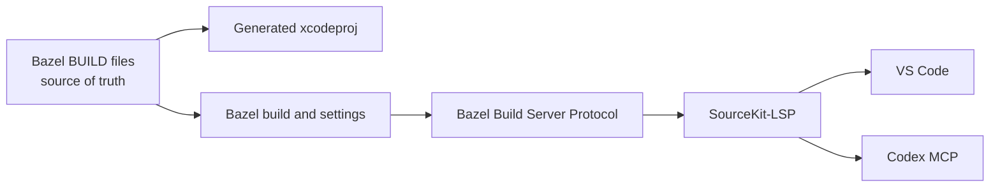

# Architecture

This sample contains a small SwiftUI iOS app and its companion WidgetKit extension.

```text
App/
├── HelloWorldApp.swift   SwiftUI application entry point
├── ContentView.swift     Main screen, NukeUI image experience, and SwiftMacros usage
└── Info.plist            App bundle metadata
Widget/
├── HelloWorldWidget.swift  Static Hello World widget
└── Info.plist              Widget extension metadata
```

`HelloWorldApp` launches `ContentView` in a `WindowGroup`. `ContentView` uses NukeUI's `LazyImage` to load the remote landscape image through the real NukeUI package dependency. It provides visible loading and connection-error states so the screen remains useful while the image is unavailable.

`HelloWorldWidget` is a separate WidgetKit extension target. It supplies a static small or medium Home Screen widget with its own timeline provider and shares the app's Hello World theme without sharing view state. Add it from the simulator Home Screen by entering edit mode, choosing **Add Widget**, searching for **Hello World**, selecting a size, and adding it.

## Build and editor ownership

The Bazel `BUILD` definitions are the source of truth for app and extension targets and their dependencies, including NukeUI. The generated Xcode project is a derived integration artifact and should reflect those definitions rather than become a second target configuration.


